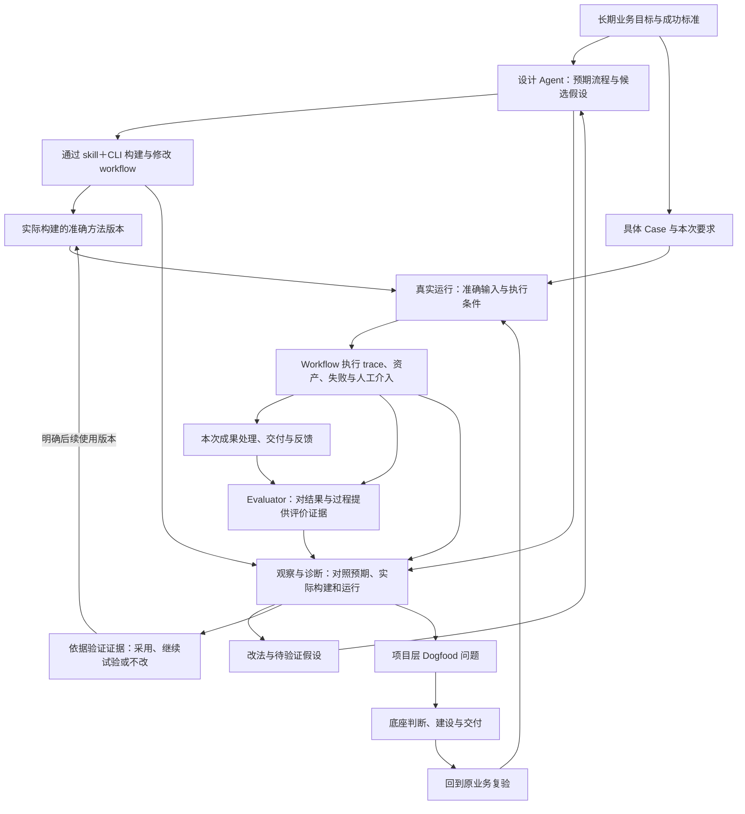

# Agent Workflow 的产品认知与文档架构

[产品入口](../vendor/agent-workflow/README.md) · [现有产品定义](../vendor/agent-workflow/docs/product.md) · [现有产品认知](product-understanding.md)

本页的范围仅为 **agent-workflow 产品**。先建立其目标、机制、角色、对象、生命周期和技术责任的关系模型，再推导文档架构。它保存 2026-10-09 的整理依据。后续实际阅读暴露出架构正文仍混杂现行合同、旧提案与实施纪事；2026-10-10 已重写技术总览及各专题，整理前全文另留历史快照。现行阅读入口是 [产品全貌与任务导览](../vendor/agent-workflow/docs/documentation.md)。下文保留原推导与迁移映射，区分已确认目标、实现证据、推论与未决问题。

## 一、先认清我们在建设什么

### 产品的长期目标与当前边界

agent-workflow 的长期目标，是把不同客户的真实业务做成能执行、能评价、能持续改进的方法。以 Space 持续承载业务目的，让人和 Agent 能设计方法、完成实际案例、使用资产、研究效果、改变方法并继续服务。这些共同构成产品的价值机制。[产品目标](../vendor/agent-workflow/docs/product.md)

**核心使用场景是公司的持续经营。** 业务中的隐含规则、例外、协作条件和实际成效，需要在使用中逐步认识；首版 workflow 是可执行的假设，其执行 trace 为后续迭代 workflow 提供依据。已经有效的方法继续承担工作，设计 Agent 从观察者视角研究偏差并验证候选。外层设计 Agent 通过 skill＋CLI 完成设计，其 session trace 先保留，未来用于提升设计 skill。这是产品选择的工作范式；适用于哪些业务、改善多少，仍要由真实业务结果证明。[根本范式](../vendor/agent-workflow/docs/product.md#根本范式真实业务中的设计观察与演化)

产品范围包含执行、资产存储与 harness、执行器接入、版本和评价迭代、通用工作台。领域方法、工具、资产正文与评价标准由业务提供；产品负责让它们能协作、被观察和迭代。当前以 CONTENT 检验部分能力，第二业务复用、一般 Agents SDK、大媒体和完整生产部署仍需各自的证据。具体实现状态由[建设状态](../vendor/agent-workflow/docs/harness-roadmap.md)维护，临时 VM 编排暂缓。[系统职责与边界](../vendor/agent-workflow/docs/architecture.md)

### 产品出发点：为什么需要它

最初的问题是：在长会话里完成一次业务，常依赖人的记忆、临时补材料、手工修稿和主持 Agent 的救场。产物完成后，未必能回答这套方法下次能否独立完成、失败到底来自哪里、哪次改动有效、换人后怎样继续。资产分散和执行条件不透明又使交接与归因困难。[问题来源](../vendor/agent-workflow/docs/product.md#为什么需要这套底座)、[目标的推导依据](product-understanding/goals-and-paradigm.md)

因此，本项目的“第一性原理”应表达为可以解释设计的出发点：

1. **价值以真实业务结果为准。** 执行完成、工程测试通过、记录齐全，都不能单独证明成果可用或人工负担减少。
2. **方法需要实际承担工作，才能被评价。** 人工补救可以发生，但要保留其归属，不能用补救后的成品证明原方法成功。
3. **Agent 的判断空间与业务边界同时存在。** 结构定义责任、交付和停止条件；节点在合同内探索，不把每次思考机械拆成流程节点。
4. **方法从实际业务中逐步形成。** 首版是有理由的假设；设计 Agent 对照预期、实际构建和实际运行，Evaluator 提供评价证据，诊断支持改动，验证之后再决定是否采用。允许不改或停止投入；执行者的完成摘要不能代替观察依据。
5. **持续协作需要准确、可恢复的工作事实。** 人和 Agent 从同一套版本、输入、资产和 workflow 执行历史理解业务，并据此迭代 workflow；界面、CLI 和工具各提供适合的使用方式。外层设计 Agent 的 session trace 另行保留，未来用于提升设计 skill，暂不要求统一接入工作流执行账本。

这些原则来自已确认的目标及实践问题，仍应接受反例检验。PostgreSQL、SDK、Archify 是承接这些目标的具体选择，分别要解释它们解决什么问题；技术名称不能代替产品目的。正式范围与取舍继续由[产品定义](../vendor/agent-workflow/docs/product.md)维护。

### 业务、方法和底座通过三个循环相连



第一条循环交付本次有用结果；第二条积累更合适的业务方法；第三条改进支撑这些方法的产品能力。它们共享证据，但责任、节奏和完成条件不同。一个 Case 不必先做实验；一个方法问题不必升级成平台项目；一个 issue 关闭也不代表业务已恢复。[调优循环](../vendor/agent-workflow/docs/tuning-loop.md)、[Dogfood 分流](product-understanding/learning-and-dogfood.md)

**两类 trace 对应不同的改进对象：** workflow 执行 trace → 观察、评价与诊断 → 迭代这条 workflow；设计 Agent 的 skill＋CLI session trace → 先保留 → 未来复盘并提升设计 skill。后一条是改进“怎样设计 workflow”的学习路径，当前不要求建成新的产品子系统。Workflow 内各节点的 trace 属于前一类。

持续经营让这三个循环长期相连：现行方法服务业务，候选在明确范围内验证，反馈可以晚于本次运行到达。发现退步时，需区分方法失效、输入或业务规则改变、执行环境故障与评价标准变化；不能把所有问题都归为 Prompt 不够好。统一存储、资产关系等 harness 建设也来自这种诊断，完成后仍须回到原业务检查效果。

这里的核心对象及其关系是：Space 保持长期业务目的；Workflow 版本保存明确的方法；Case 可由不同方法版本多次处理；Run 固定这次执行的输入和条件；资产保留准确内容及来源；评价说明判者、标准和范围；分析解释问题；变更与采用决定影响后续工作。方法版本、运行次数、业务轮次和资产修订分别计数。它们构成产品架构，页面和数据库再据此设计。[现有对象定义](../vendor/agent-workflow/docs/product.md#必须分清的对象)、[生命周期](../vendor/agent-workflow/docs/product.md#工作流的完整生命周期)

这条主线还必须展开到以下准确关系，才能支持诊断和接手：输入清单（manifest）绑定本次使用的资产版本；run 内的节点实例、业务轮次和技术 attempt 分别记录；运行 session／trace 连接该次执行的配置、交付材料与可观察事件；review／comparison 绑定被评产物、基线、标准和判者；iteration 连接原问题、改动、候选与验证；adoption 保存有权者对适用范围的决定。记录缺失时保留未知，不用后来解释补写当时事实。产品架构应说明这些关系，完整字段与 API 留给技术合同。

外层设计 Agent 的 session 暂保留原记录及可找回的来源，需要时可引用对应目标或方法版本。保留这类会话是为以后提升设计 skill 积累材料，不要求现在自动关联所有会话、统一入库或增加前端栏目。方法版本仍需说明设计目标、改动原因与验证依据，不依赖外层会话已完整接入产品。

### 谁在这些循环中作判断

| 角色／责任 | 需要完成的判断与工作 |
| --- | --- |
| 业务使用者 | 提出要求、提供材料、处理运行中的问题、判断成果是否可用与如何交付 |
| 设计 Agent／方法设计者 | 通过 skill＋CLI 形成预期流程与首版，依据 workflow trace 设计和验证下一版；自身 session trace 先保留，用于以后改进设计 skill |
| 观察与诊断者 | 对照预期、实际构建、实际运行及业务结果，辨别差异意义与原因；可由设计 Agent 承担，但需检查自己的假设 |
| 节点 Agent／程序 | 按具体输入、输出及权限合同完成职责，留下准确产物和可观察记录 |
| Evaluator／审阅者 | 在明确标准和材料范围内评价结果，说明证据、分歧和未知，不自动替代采用决定 |
| 有权的采用决定者 | 对明确适用范围决定采用、继续验证、回退或停止；用户保有最终判断，受托者须获得这项决定的授权 |
| 产品认知与维护者 | 解释实践暴露的问题，区分方法与产品层责任，判断建设方向并组织回到真实业务复验 |

同一个人或 Agent 可以承担不同责任。观察环节围绕原目标和原始证据重建判断上下文，减少被执行中的局部目标和临时处置牵引；这不保证观察者天然正确，也不要求必须采用不同模型。业务方法的设计、观察、独立评价、产品认知和业务执行仍需分清。工作流中的执行 Agent 使用节点工具；负责认知的 Agent 通过 skill＋CLI／tool 取证，必要时还要代理用户实际使用前端。它们不是同一个“Agent 功能”或一种固定权限。[角色与对象的依据](product-understanding/responsibilities-and-objects.md)

首版可以从新业务意图形成，也可以从已有 session、产物和失败中恢复。候选可改变节点、流程、Prompt、工具、上下文、可选 skill 或已支持的执行器；skill 是可能的知识封装，不是所有迭代的必经步骤。稳定方法持续服务，候选可以同时研发；停用和接手仍保留旧版及其证据。[方法形成](product-understanding/lifecycle-and-methods.md)、[设计指南](../vendor/agent-workflow/docs/designing-workflows.md)

### 技术层与前端各自承担什么

共享执行核心承担步骤、分支、并行与恢复语义；执行器把 Agent 或程序节点变成实际工作；harness 装配输入、配置与允许的能力，接收产物和执行记录；共享存储保存准确事实；服务接口支撑人的工作台和 Agent 的 CLI／tool。业务层提供方法、领域工具、资产正文、标准及专用阅读器。核心包保持独立，不因为产品范围扩大就依赖全部存储、执行器或界面。[系统架构](../vendor/agent-workflow/docs/architecture.md)

前端帮助人理解这些事实、完成决定并继续工作。日常业务从 Case 与结果进入，研发从准确方法进入，复用从资产进入；关系图沿用 Archify，选择对象后展开详情。方法预期产物、Case 实际资产、版本演化分别表达不同语义，检索与对账可以使用列表。前端逻辑不能替代缺失的存储或执行能力。[交互定义](../vendor/agent-workflow/docs/workbench-presentation.md)、[当前线框提案](product-design/wireframes.md)

## 二、认知在这套体系中的位置

**认知是一项持续形成、检验和修正判断的活动，也会产生可保存的模型与论证。** 它作用于产品目标、架构、交互、建设取舍和实际使用，不应成为所有项目知识的统一存放类别。

```text
目标、问题、真实任务与证据
    → 认知：解释关系、提出假设、比较方案、用反例检验
    → 沉淀：产品定义 / 产品架构 / 交互设计 / 技术方案 / 建设决定
    → 实施与实际使用
    → 新证据和新问题，修正上述判断
```

需要分开保存三种内容，且彼此可追溯：

| 内容 | 读者得到什么 | 合适的位置 |
| --- | --- | --- |
| 成形的定义和设计 | 产品是什么、应怎样工作、当前采用哪种方案 | 产品、架构、交互或相应规范文档；开头可直接读到摘要 |
| 推导与设计理由 | 为什么这样判断、竞争方案是什么、哪些观察会推翻它 | 认知论证或设计依据；保留完整的有效推理，不一律缩成索引 |
| 原始材料与观察记录 | 当时实际请求、做过的核查、运行或审阅结果，以及证据限制 | 历史／验证记录或受控原始数据；由结论页按需链接 |

“旧文档很长”不等于它是 raw。对象关系的严密论证、业务方法、失败反例和操作指南都有独立价值；日期化方案也可能仍有效。必须按**这段内容回答什么问题、承担什么责任、当前是否有效**判断归属，不能只按文件名或是否有日期搬迁。

已有认知六章保留了目标来源、首版方法形成、角色和对象关系、证据强弱、Dogfood 分流与审阅方法。已有 vendor 文档已经承接大量正式要求。两者应建立清楚的引用与修订关系，不能一边新增“规范”，一边让另一份旧规范继续独立变化。

## 三、文档架构首先服务哪些读者任务

| 读者此刻的任务 | 应能连续读到什么 | 不必先通读什么 |
| --- | --- | --- |
| 初次了解产品 | 为什么需要 agent-workflow → 它怎样产生价值 → 完整产品范围与当前阶段 | 全部认知历史和实现日志 |
| 理解或决定共享产品方向 | 初始问题和目标 → 价值机制与原则 → 产品对象、场景和生命周期 → 设计取舍与未知 | API 和数据库明细 |
| 判断前端是否合理 | 关键任务和对象关系 → 已确认交互 → 布局／逐页线框 → 状态、动作与场景检验 | 先读完所有 React 包和通信实现 |
| 设计、运行或调优一个业务方法 | 业务目标与领域标准 → 预期流程与首版构建 → 实际执行 → 观察差异／评价／归因 → 验证和采用 | 产品负责人每一轮认知会议 |
| 开发或接入共享能力 | 产品责任 → 系统边界 → 对应存储／执行／前端合同 → 当前接口 → 建设状态与验收 | 与当前能力无关的领域内容 |
| 日常使用一个已有 workflow | 本次要求与材料 → 合适版本 → Case／运行与成果 → 处理与反馈 | 每次业务都重新设计方法或建立实验 |
| 审阅判断、排障或接手 | 当前结论与适用范围 → 设计理由 → 准确历史证据 → 未解决问题 | 从全部聊天记录重新猜产品目标 |

因此，目录首先按产品内的读者问题组织；页面内部按“摘要 → 主要定义或决定 → 必要细节 → 推导和证据”展开。网站应将散在“产品推导”和现有“agent-workflow”分组中的同一产品知识串起来。文档网站的导航服务学习与查阅，不照搬工作台产品的左栏。

## 四、由此推导出的目录提案

```text
Agent Workflow
  导览：产品全貌与按任务阅读
  产品目标与原则
    为什么做、为谁做、业务中逐步形成方法、价值、范围与成功标准
  产品架构
    核心对象与关系、设计/观察/执行/评价职责、生命周期、三个循环
    Workflow 执行证据与方法迭代、harness 演化的连接
  前端与交互设计
    已确认交互 → 布局与页面线框 → 内容、状态和动作 → 场景验证
  系统技术架构
    分层与扩展边界 → 方法/执行/资产合同 → 存储与执行器 → 前端技术
  工作流设计与调优
    预期与首版构建 → 执行与交接 → 观察、评价、归因与候选验证
    采用、持续服务、运营反馈与复盘
  使用与开发接入
    快速开始、编写 API、宿主/节点/存储/前端接入
  建设状态与路线
    当前能力、缺口、实施安排和验收范围

  认知方法与设计依据
    怎样从问题建立模型、推导、反驳和修正
    本产品的重要推导与开放问题
  历史与验证证据
    Workflow 运行证据、设计 Agent session 的保留说明、决策来源与走查
    旧方案与迁移记录；设计 session 未来用于改进设计 skill
```

这不是要求马上新建每一行对应的文件或增加顶层菜单。目标、产品架构、前端逻辑、技术架构需要可独立进入的摘要；已有正文可以通过分组和交叉链接承担细节。后两组是追溯入口，不应成为初次理解产品的必经入口，也不因此失去其推理价值。

其中“产品架构”首先是把现有对象、责任和生命周期连起来的阅读入口。现有产品规范继续由 `product.md` 维护，交互与技术责任分别由对应合同维护；是否物理拆出新文件，在逐段核对独有内容后决定，不同时维护两套对象定义。

### 根本思考怎样决定内容归属

| 已确认的出发点 | 由此必须说明的产品关系 | 文档应承担的责任 |
| --- | --- | --- |
| 方法要在真实经营中逐步调到合适 | 在用版本持续服务，业务反馈支持候选验证与采用 | 产品目标解释为什么；生命周期解释如何共存；设计与调优指南说明怎样做 |
| 设计 Agent 需要观察预期与实际的差异 | 预期流程、实际方法与实际运行分别有依据；观察、评价和采用职责明确 | 产品架构说明责任和关系；方法指南说明如何取证与诊断 |
| 两类 trace 有不同的学习用途 | Workflow trace 支持迭代 workflow；外层设计 Agent session 先保留，未来提升设计 skill | 产品架构与技术合同说明 workflow 执行证据；设计 session 暂记保留用途与来源，不新增统一追踪合同 |
| Harness 从 session 中发现的问题逐步改进 | workflow 调优和 dogfood issue 分流；底座交付回到业务复验 | 产品原则解释来源；建设状态保存进展；设计依据保留为什么这样改 |

“历史与验证证据”提供可查阅的记录和索引，私有业务 trace 保留在受控存储中，不因增加文档栏目就复制进公开站点。认知章节解释这些机制怎样被推导和修正；正式产品关系与使用步骤仍放在各自文档中。

### 四种“架构”不要混为一谈

| 类型 | 核心问题 | 主要产物 |
| --- | --- | --- |
| 产品架构 | 哪些工作对象、角色和机制共同完成业务、积累方法 | 对象关系、场景、生命周期与责任模型 |
| 前端逻辑架构 | 人如何找到、理解和操作这些对象，怎样继续任务 | 导航、主体、图与详情、状态、动作及返回路径 |
| 系统技术架构 | 哪些模块实现这些责任，数据和控制如何流转 | 包／服务边界、合同、接口、运行与部署关系 |
| 文档信息架构 | 谁需要理解或使用哪部分知识，读序和权威来源是什么 | 阅读路径、内容归属、摘要层级与引用关系 |

认知为四者提供推导与检验的方法；它不能通过一个同名章节替代任何一种成形设计。

## 五、已有文档怎样安放

以下保存整理前依据内容核对得到的归属；实际实施与保留核对见末尾记录。优先保留写得好的正文，先补摘要、定位和链接；确有重复时再逐段决定哪处保留完整定义。

| 现有材料 | 在新架构中的责任 | 拟处理方式 |
| --- | --- | --- |
| [agent-workflow README](../vendor/agent-workflow/README.md) | 产品与使用总入口 | 保留；补清按任务阅读路径，避免要求所有人先读认知六章 |
| [共享 product.md](../vendor/agent-workflow/docs/product.md) | 产品初始问题、目标、原则、范围与规范 | 保留其已确认内容；在开头形成简明摘要，把目标与现状分别定位 |
| product.md 的对象、生命周期与完整版本章节；[对象推导](product-understanding/responsibilities-and-objects.md) | 产品架构的规范与理由 | 先确定规范归属；可从现有正文提炼独立概览，不重建一套冲突定义；论证仍保留来源 |
| [目标与范式](product-understanding/goals-and-paradigm.md) | 从实际问题到产品机制的推理 | 保留问题映射和推断边界；正式原则引用产品定义，收益假设继续可反驳 |
| [生命周期与方法](product-understanding/lifecycle-and-methods.md) | 为什么方法这样形成、候选与 skill 怎样取舍 | 保留首版推导和两张方法图；使用步骤接到正式工作流指南，不强制 skill 化 |
| [判断与证据](product-understanding/decisions-and-evidence.md)、[Dogfood](product-understanding/learning-and-dogfood.md) | 冲突条件下的推导与跨层归因 | 保留证据强弱、验证分母、采用后果和分流理由；源码核查保留时点，不能悄悄升级成永恒保证 |
| [认知验证](product-understanding/review-and-validation.md) | 如何审阅、检验和修正产品判断 | 方法与某次实际审阅结果可分别定位；先保留原文与反例，再决定是否拆记录页 |
| [workbench-presentation.md](../vendor/agent-workflow/docs/workbench-presentation.md) | 正式交互要求及明确标注的编排提案 | 作为前端设计的规范入口；保留 Archify 基础，区分已确认合同与候选排列 |
| [布局](product-design/layout.md)、[线框](product-design/wireframes.md)、[状态与动作](product-design/decisions-and-states.md)、[场景](product-design/walkthroughs.md) | 对应当前交互要求的具体设计与验证材料 | 保留；对象理论引用规范，合成样例和未验证动作继续清楚标注 |
| [系统架构](../vendor/agent-workflow/docs/architecture.md)、[前端技术](../vendor/agent-workflow/docs/space-frontend-architecture.md) | 系统与前端实现的职责和协作 | 保留技术论述；实现状态回链 roadmap，过时的交付描述在核实后修订 |
| [Space](../vendor/agent-workflow/docs/workflow-spaces.md)、[过程与资产](../vendor/agent-workflow/docs/workflow-process-assets.md)、[存储/SDK 方案](../vendor/agent-workflow/docs/postgres-sdk-plan.md) | 跨模块详细合同与技术方案 | 进入技术架构下的专题；方案与已提供 API 的指南分别入口 |
| [设计](../vendor/agent-workflow/docs/designing-workflows.md)、[评估](../vendor/agent-workflow/docs/evaluating-workflows.md)、[优化](../vendor/agent-workflow/docs/optimizing-workflows.md)、[调优](../vendor/agent-workflow/docs/tuning-loop.md) | 产品操作者怎样形成和改进业务方法 | 保留为一条完整工作路径；不与“如何认知这个产品”的方法混为一类 |
| 快速开始、[编写 API](../vendor/agent-workflow/docs/writing-workflows.md)、[宿主集成](../vendor/agent-workflow/docs/integration.md)、[存储使用](../vendor/agent-workflow/docs/space-storage.md)、[PG 账本](../vendor/agent-workflow/docs/postgres-storage.md)、[前端读模型](../vendor/agent-workflow/docs/frontend-integration.md) | 当前接口的使用和接入 | 保留命令、示例与能力边界；按接入任务串联，不夹入产品原则正文 |
| [建设状态](../vendor/agent-workflow/docs/harness-roadmap.md)、[实施计划](../vendor/agent-workflow/docs/space-frontend-implementation-plan.md) | 当前事实、缺口及建设安排 | 保持唯一状态入口；阶段证据支持限定结论，不替代产品验收 |
| [实用迭代记录](../vendor/agent-workflow/docs/cognition-execution-loop.md)、日期化交付、[历史原型](product-design/prototype-round.md) | 发生过什么、判断为何改变 | 可由证据索引聚合，保留旧链接；真实运行、合成走查和书面推演分别表达 |

上述归属同时说明维护边界：产品规范、系统合同与当前接口继续在 agent-workflow 维护；现有认知和页面设计提供理由与提案。网站不必照抄源文件的物理目录，也不应为视觉整齐制造两份独立维护的规范。

## 六、还有哪些认识需要核实

本轮已核对 agent-workflow 的产品和系统架构、交互合同、方法设计、建设状态、认知六章及页面设计材料，并由独立核对者检查内容职责与重叠。它支持上面的内容归属判断；没有重新运行 workflow 或核验全部实时接口。

| 尚不能直接下结论的地方 | 对整理的影响 |
| --- | --- |
| 系统架构里仍有“新前端包与 HTTP API 尚未实现”，建设状态却已记录共享前端/API 接入 | 明确存在文档时态冲突；后续依当前源码和建设证据修订，不通过目录搬迁自动选择一个说法 |
| Codex、SIWC Responses 与一般 Agent SDK 在不同文档中接近出现 | 按实际接入区分：可用的 Responses 适配器不等于通用 Agents SDK 已完成；目标、方案和使用指南需对齐 |
| 版本评分机制与部分采用／派发规则仍未定 | 文档架构提供其位置，保留未知；不能为章节完整补造规范 |
| CONTENT 的局部工程路径、成果质量与第二业务可复用性有不同证据 | 不能把“实现状态”“业务验收”“通用成熟度”合成一个完成徽章 |
| 某些设计规则已有原则，具体执行与前端行为尚为提案 | 每处标明规范、方案、已实现或已验证的范围；不把迁入规范目录当成用户接受 |

## 七、据此怎样整理，怎样知道没有整理坏

整理的依据现在是：**项目边界 → 价值与三个循环 → 角色和读者任务 → 知识之间的依赖 → 文档职责 → 目录和页面内容。** 导航只承载最后两步。

落实时先以现有文件形成新的阅读路径和摘要；对重复定义标明主要维护位置；再逐篇比较独有内容，决定交叉引用、抽取概览或迁移，保留原锚点和来源。不会把所有旧认知文章批量改成短索引，也不根据目录提案立即重写产品。

检查五条实际查阅任务：新读者能否解释为什么做；设计者能否从对象和场景推到页面；开发者能否从产品责任找到合同与当前接口；业务操作者能否不绕过领域标准而完成自己的任务；接手者能否从当前判断追到历史依据。若只是目录更整齐却让这些路径变长，就需要修正结构。

以上保留整理前的项目理解、目录理由与逐篇归属，作为本次实施依据。现行网站分组和阅读入口已按下节落实，后续仍应在出现新事实时修订对应权威文档。


## 八、实施记录（2026-10-09）

本轮只整理 agent-workflow 文档及相关入口；Markdown 为源，站点由构建生成。三个业务工作台的正文与导航保持原样，未修改 skill、产品功能或存储，没有运行付费模型、提交、推送或部署。

### 实际迁移映射

| 原位置 | 现行阅读位置 | 保留方式 |
| --- | --- | --- |
| 产品推导、agent-workflow、实施与复盘三个站点组 | 单一 Agent Workflow 产品组，下设九个可展开知识组 | 只调整导航归属；原 Markdown 和生成页面 URL 保留 |
| README 的产品／接口混合入口 | [产品全貌与任务导览](../vendor/agent-workflow/docs/documentation.md)，README 继续承担仓库与运行说明 | 原 README 正文、示例、命令和包表保留 |
| product.md 的目标、对象与生命周期 | 目标组保留正式定义；[产品架构概览](../vendor/agent-workflow/docs/product-architecture.md)连接对象、责任、场景和图 | 概览引用原规范，未拆出第二套独立规则 |
| 交互合同与根目录产品设计 | [交互导览](../vendor/agent-workflow/docs/interaction-design.md)连接合同、布局、线框、状态、走查 | 独有正文与十二张线框原位保留；历史原型进入证据组 |
| 系统架构、Space、过程资产及 SDK 方案 | 系统技术架构组 | 合同正文不迁走，过时 API／前端实现时态依源码做限定修正 |
| 设计、评估、优化、调优指南 | [完整方法工作路径](../vendor/agent-workflow/docs/workflow-practice.md) | 保留原操作说明，串联采用、持续服务和窗口复盘 |
| 快速开始、API、Codex、存储、宿主和读模型 | [接入任务导览](../vendor/agent-workflow/docs/usage-and-integration.md) | 保留当前命令、代码示例、恢复及权限边界 |
| 六章认知 | 认知方法与设计依据组 | 完整论证不压缩为索引；正式关系和使用步骤分别回链规范／指南 |
| 日期化交付、原计划、实用审查、原型及方法包核查 | [历史与验证证据](../vendor/agent-workflow/docs/history-and-evidence.md) | 新增原未进导航的过程资产及 Archify 记录，原 URL 保留 |

### 重要资产与事实边界

生命周期原 SVG／交互 HTML 从产品架构可读可点；候选方案／skill 原 SVG／交互 HTML 从方法工作路径可读可点。[原生命周期论述](product-understanding/lifecycle-and-methods.md)仍同时保留两张图、转换依据和候选选择理由。[线框文章](product-design/wireframes.md)及十二张 SVG 保留；所有图的编辑源、candidate JSON、生成器及历史版本不删除、不重画。

当前代码具有共享 React 工作台、有界 HTTP 读写及 creation 同源接入。architecture.md 与 workbench-presentation.md 的过时时态据此修正；完整产品、一般 Agents SDK、生产媒体能力及业务效果的完成边界仍按 roadmap 维护。Workflow trace 与外层设计 session 的两种学习用途保持分开；外层 session 不新增统一入库或前端建设要求。版本评分和适用规则的未决项继续保留。

### 验收记录

使用 Node 24.21.0 执行 `pnpm docs:build`，生成 85 页，内部文档链接与锚点检查通过；根仓库与 vendor 的 `git diff --check` 均通过。对照执行前基线：212 个原文件无缺失，164 个图资产哈希全部相同，原 Markdown 标题无丢失；原 76 个导航页面仍全部生成在相同 URL。Creator Lab、创作、研究与分析导航块逐字核对未变。

| 读者任务 | 浏览器走查结果 |
| --- | --- |
| 新读者理解为何存在与根本范式 | 从任务导览展开目标组，进入正式产品定义，能继续到对象／生命周期和唯一状态入口 |
| 设计者从对象、场景进入交互 | 从产品架构进入交互导览，找到合同、布局、状态和场景；十二张线框 SVG 均正常加载，点开原 SVG 成功 |
| 开发者找合同、接口和状态 | 系统组、接入组及建设状态组实际展开并进入；三类文档责任可辨，当前实现与目标边界明确 |
| 操作者理解设计到持续服务 | 方法工作路径连续链接设计、API、运行接入、评价诊断、候选、采用和窗口复盘；原调优步骤继续保留 |
| 接手者追依据与历史 | 认知与历史组实际展开并进入，完整六章、日期化交付、原计划、实用审查和历史原型可查 |
| 生命周期与方法图可读可点 | 新架构页原 SVG 正常加载，原生命周期交互 HTML 点击打开；方法页原 SVG 正常加载，候选方案交互 HTML 点击打开，图控件与文字可读 |

浏览器使用 ego-browser，目录展开与页面导航通过。两次高层点击在长图／图片链接附近被正文拦截，改用现场坐标或 DOM 原生链接点击后成功；生命周期图截图接口超时，因此以浏览器页面内容、图控件、图片加载及链接打开验证，没有宣称完成截图视觉验收。本次验收只说明文档能否查阅和资产是否保留，不证明工作流质量或产品业务效果。
