# 页面线框与推导原则

[返回产品设计](README.md) · [完整认知](../product-understanding.md) · [决定规则](decisions-and-states.md)

**这一版保留已经说通的产品逻辑，以静态线框说明页面和交互；沿用现有 Archify 主画布及点击详情的基础。** 2026-10-09 用户明确不需要继续交付可操作低保真。以下图是布局与内容责任的说明，不是生产界面截图，也不表示缺失能力已经实现。

## 从什么原则推导这些页面

先恢复用户已经确认的目标和交互基础，再沿下面的依赖推导：

**要完成的业务或判断 → 当前准确对象与范围 → 必须取得的内容和证据 → 合适的主体形式 → 点击后怎样读、怎样决定 → 保存结果怎样影响下一步。**

本项目的具体推导是：业务目标会长期存在，所以由 Space 保持范围；同一方法会不断改进，所以 workflow 下要有准确版本；认识一版方法需要来回读目标、机制、案例、评价和改法，所以版本标题展开这些子入口；真实运行会留下互相关联的资产，所以从 Case 进入实际关系与内容；下一版必须有依据，所以评价、调优及版本谱系连成可追溯的路径。稳定服务与候选试验可以并行，因此生命周期不是一条强迫用户依次点击的向导。

| 原则 | 为什么成立 | 对本项目布局的约束 |
| --- | --- | --- |
| 沿用已确认且仍适用的交互基础 | 本轮在改善产品认知与信息关系，用户没有撤回 Archify 图中心方向 | 使用现有画布、节点选择与详情阅读；新增预期资产、完整案例范围和版本演化等信息。不能借“低保真”改成另一套卡片工作台 |
| 长期对象决定工作范围，关键任务决定对象内的入口 | 同一版本需连续研究目标、方法、案例、评价和后继；生命周期各阶段又可能同时发生 | Space 固定业务目标，workflow 标题可展开，版本形成稳定上下文；日常 Case 与跨案例资产另有入口，共用对象 |
| 展示形式服从要作的判断 | 看关系、找对象、读成果与提交决定是不同任务 | 理解流程、资产关系、改动因果和谱系用 Archify；检索与完整集合对账用列表；正文用阅读器；Agent 经 skill＋CLI 写入后，前端就近展示准确结果、依据和后果；已有轻操作可保留 |
| 默认显示关系与重要状态，按选择展开细节 | 用户需要先认识整体，再读某个对象；完整 Prompt 和长文常驻会挤走全图 | 中央画布是主要工作区；点节点、资产或变更关系打开右侧详情；长文可扩大／并看，关闭后恢复选中对象、缩放与阅读位置 |
| 预期、发生、解释和决定分别表达 | 计划产出不是实际资产，一次评价不是采用，一条相邻关系不是因果 | 方法图、Case 实际资产图、分析／演化图分别说明语义；关系可追到准确依据，缺失保持未知 |
| 每次跳转和保存都承接原对象 | 上轮原型曾把新草案的第一项委托默认绑定到旧 workflow，页面各自合理却做错了任务 | 从版本发起动作携带该版；从草案建立委托携带当时草案；从 Case 追来源后能回来；修改草案不能改写旧委托 |
| 判断要有范围，动作要有后果 | 当前查看、已采用、可执行、已评价是独立状态 | 头部说明准确版本与观察范围；采用影响什么业务、启动使用哪版分别可读；缺材料、未开始、未评与不可执行不能被成功样例掩盖 |
| 一次业务与改进方法共享证据，各有结束条件 | 委托人要可用成果，维护者要有依据的改法；不是每次委托都需要做实验 | 日常从业务案例进入；问题可带证据进入调优；调优允许不改、补证据或提出 dogfood issue，不强迫产生下一版 |

这些视图同时依赖同一套项目事实：人通过工作台阅读，认知 Agent 经 skill＋CLI／tool 读取，代理用户的 Agent 则实际操作前端。不能各维护一套版本、资产关系或评价摘要。前端是否让人看懂，需要单独检查；命令能查到信息不能替代它。

当前主路径是用户在对话中交代目标或修改，Agent 通过 skill＋CLI 形成、修订和执行，前端供人和 Agent 阅读、判断与追溯写入结果。线框中的表单与按钮说明动作应保留的对象上下文，可作为已支持或未来可选的轻交互，不作为前端编辑器的阶段验收前提。

Archify 是已确认的本项目选择，不是从上述通用原则推导出的唯一技术方案。现有实现已经具有方法／运行图、点击节点后的详情、资产阅读与部分关系入口；预期资产入图、完整 Case 资产关系和版本谱系仍有待补齐的部分。依据见[工作台定义](../../vendor/agent-workflow/docs/workbench-presentation.md)、[现有查看器](../../vendor/agent-workflow/docs/archify-viewer.md)及[实现边界](layout.md#7-当前实现究竟覆盖了哪些)。

业务心智模型／生命周期、方法及预期产出、运行／资产关系和版本谱系凡需 HTML 图，统一复用已有 Archify 集成与交互查看器，由准确合同或证据生成并保留点击详情及返回；Archify 生成的内联 SVG 与静态预览可保留，不另造手写 HTML／SVG 查看器，图的检查也不代替真实产品使用。

各张线框均可点击查看原尺寸；图中的框表示内容位置，具体图形与交互沿用 Archify。

跨页示例共用相同身份：Case A 的 R1／R2 使用 v1，R3 使用 v2；Case B 的 R4 使用 v1。验证计划 P 含 A／v1、A／v2、B／v1、B／v2 四项，R2 是计划外补材运行，B／v2 尚未开始。v1 已采用但暂不可执行，v2 可试跑而未采用。P01 与 P11 的首版设计另外展示初建 Space 的状态。以上均为说明用数据。

## P00 共用外壳：范围、画布和详情

[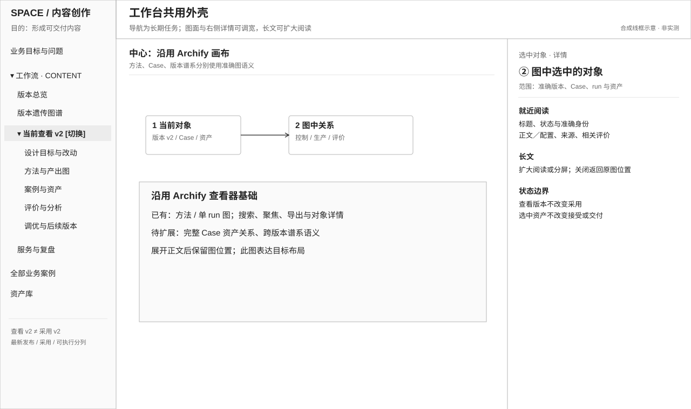](../diagrams/product-wireframes-20261009/00-shell.svg)

左栏承载长期工作对象及其任务；它不承载每次工具调用或每个数据库对象。顶部区分正在查看的版本、采用范围与执行条件。默认没有选中对象时，画布使用完整可用宽度；选择后打开详情，宽度可调，正文可扩展为阅读或比较视图。

“页面”在这里指同一外壳内的一种工作视角，不意味着每次换整套界面。只有切换业务范围、准确版本或 Case／run 集合时才重取对应图；只打开详情不应销毁图。列表也可以选择对象并复用同一阅读区。

| 页面／状态 | 核心问题 | 主体 |
| --- | --- | --- |
| [P01 业务目标与问题](#p01-业务目标与问题) | 为什么做，什么结果有用，什么仍未知 | 简明目标、标准、问题及方法入口 |
| [P02 版本总览](#p02-workflow-版本总览) | 有哪些方法版本，分别为什么存在、在哪使用 | 可比较列表，选中版本读摘要 |
| [P03 设计目标与改动](#p03-当前版本的设计目标与改动) | 这一版为解决什么问题而产生 | 短说明、问题与改动证据关系、详情 |
| [P04 方法与产出](#p04-方法与预期产出图) | 这一版计划怎样完成业务，各 Agent 交出什么 | Archify 方法／预期资产图 |
| [P05 案例与资产](#p05-从版本案例集合进入-case-与实际资产) | 在哪些实际任务上发生了什么 | 版本 Case 集合 → Case／run 范围 → Archify 实际关系图 |
| [P06 评价与分析](#p06-评价与分析) | 有什么评价，证据覆盖到哪，能得出什么判断 | 范围说明、综合判断、计划对账及原评价 |
| [P07 调优与后继](#p07-调优与后继版本) | 从发现到改法，怎样验证并决定 | Archify 分析／演化关系，选中后读证据与动作 |
| [P08 版本谱系](#p08-workflow-版本遗传图谱) | 方法如何分支演化，为什么继承或回退 | Archify 真实版本关系图 |
| [P09 服务与复盘](#p09-服务与复盘) | 已采用方法服务得怎样，哪些委托需要处理 | 采用范围、观察窗口、表现与待处理集合 |
| [P10 全部案例／资产库](#p10-全部业务案例与资产库) | 从具体业务或材料出发怎样查找和复用 | 列表／检索，接入同一画布与阅读器 |
| [P11 首版与新委托操作](#p11-首版设计与新委托是操作不是新的后台) | 如何形成方法、把准确方法用于这次要求 | Agent 写入后在当前对象旁读回条件、结果与来源；可选轻操作保留同一上下文 |

## P01 业务目标与问题

[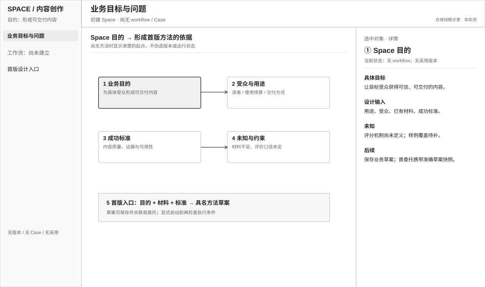](../diagrams/product-wireframes-20261009/01-goal.svg)

进入时要知道 Space 服务谁、什么用途值得完成、约束和成功标准是什么。无 workflow 时，主要动作是带着目的、样例和未知形成首版；已有方法时，进入相关方法或开始业务。这里不把创建 workflow 的技术配置当成业务目标。

主体承载一份可修订的业务理解，包含基于当前认识提出的关键业务步骤、理由、想法与未知；正文需要实际内容和来源，不能以一句用途或若干空字段算完成。业务步骤暂不等同技术节点。保存当前理解后，可以据此形成首版设计；操作可由 Agent 经 skill＋CLI 驱动，前端让人能阅读、核对和参与修订。具体内容责任见[首版设计依据](../../vendor/agent-workflow/docs/product.md#首版也要保存为什么这样设计)。

点击问题读原 Case、使用反馈或项目引用；发现底座缺口时沿 dogfood 路径处理。目标变化应说明哪些方法和评价受影响，不覆盖历史判断。首版也可能因关键材料不足而停在设计草案。

## P02 Workflow 版本总览

[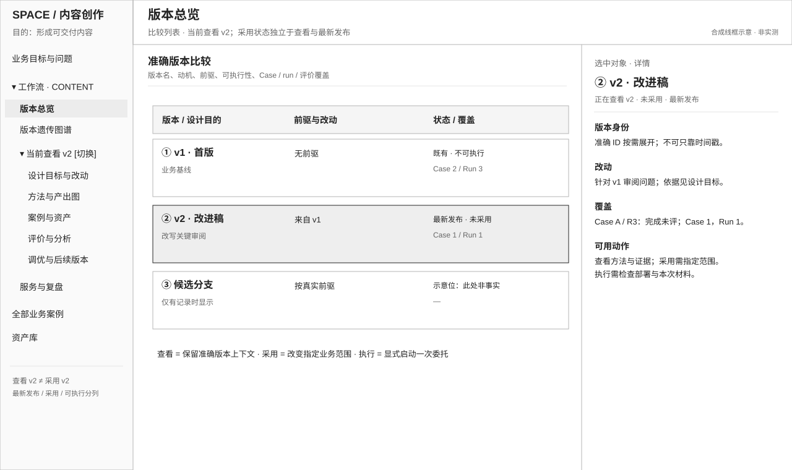](../diagrams/product-wireframes-20261009/02-versions.svg)

先比较版本号、设计动机、前驱、实际案例及评价覆盖、采用范围和执行可用性。列表适合回答“有哪些”和查找准确对象；谱系另负责看演化关系。

选中一行先读该版摘要，再明确进入其完整工作上下文；切换版本后保留同类任务，例如从 v1 的评价切到 v2 的评价。选择查看不触发采用、运行或发布。版本总评分尚未定义，不能用虚构分数排名。

## P03 当前版本的设计目标与改动

[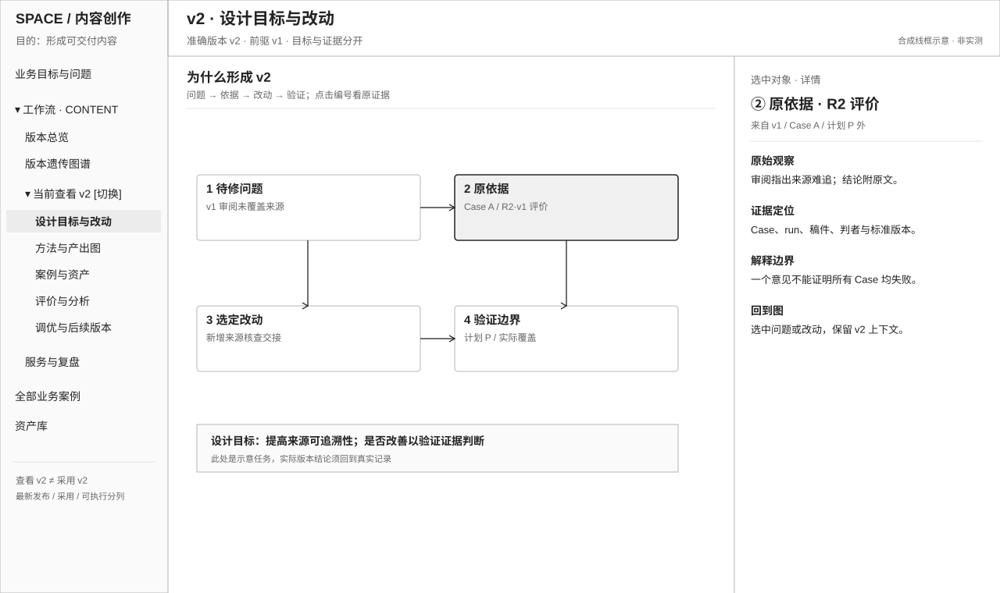](../diagrams/product-wireframes-20261009/03-motive.svg)

顶部简述这一版的目标和设计假设；主体解释首版的依据，或后继版如何从原问题、证据和改法产生。存在关系时沿用 Archify 的选择和详情；连续理由用短文阅读，不把每个句子强造为图节点。

首版需要明确本版执行目标和边界、为何选这些步骤与职责、预期交付什么、哪些关键取舍仍待验证，并引用形成该版时的 Space 业务理解。没有 run 也应读得懂；部署登记说明和版本元数据不能代替这份设计。Space 后来更新时，可回看当时依据，也能辨别当前认识的变化。

点原问题或证据读准确 Case、资产和评价；点改动看影响哪些节点、输入或执行条件。读完可进入完整方法和验证结果。前版的“后继改动”和本版的“产生动机”引用同一条变更，不各维护一份故事。

## P04 方法与预期产出图

[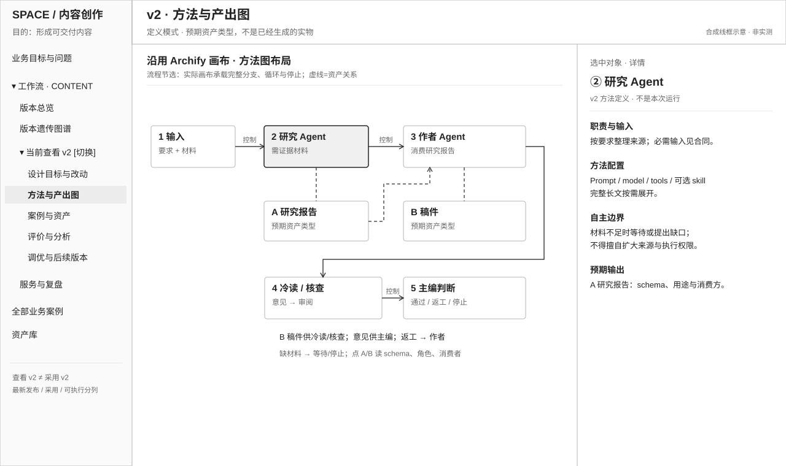](../diagrams/product-wireframes-20261009/04-method.svg)

**中央沿用现有 Archify 画布。** 在已有节点、控制边、分支与返工基础上，把关键 Agent 预期交付的资产及下游用途表达出来。方法从未运行过，也应该可读；控制允许关系与资产交接关系使用不同标记。

点击 Agent，右侧先读职责、输入、输出、自主空间与升级条件，Prompt、tools、可选 skill、执行器和配置按需展开。点击预期资产，读角色、合同、用途和可能生产它的节点；它不是已存在的资产正文。选择真实 run 后，可进入实际记录核对，声明与实况始终分开。

核心结束判断是“我是否理解这版准备怎样完成业务，哪里需要 Agent 自主判断，何时返工或结束”，不是“图里有多少节点”。

## P05 从版本案例集合进入 Case 与实际资产

[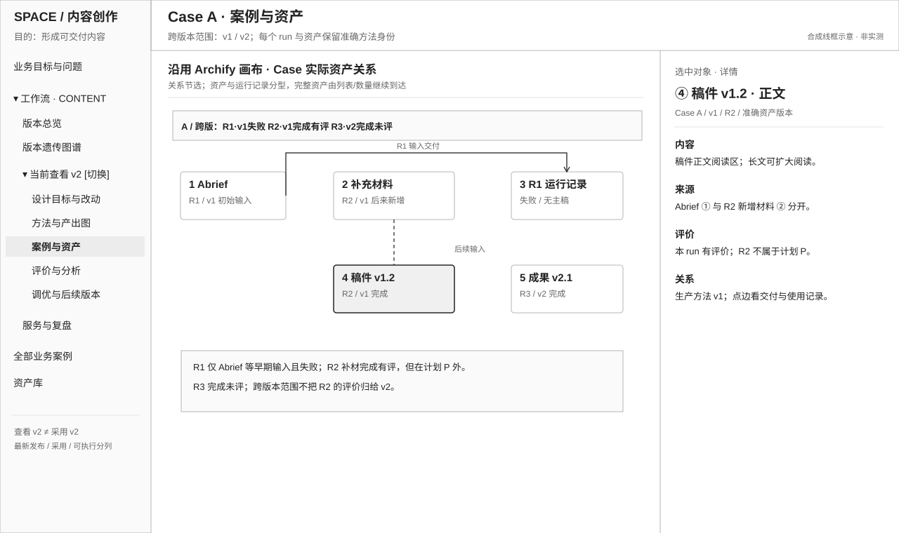](../diagrams/product-wireframes-20261009/05-case.svg)

版本入口先给出该版所有已记录 Case，以及每例的 run 次数和状态；这是完整集合的检索入口。选定 Case 后，主体转为实际资产关系画布，保留“当前版本／跨版本”范围和 run 选择。图中的输入按每次实际交付记录，不能把后来补充的材料倒填进早期 run。

点击准确资产，右侧默认读正文，再看来源、生产节点、对应评价与执行证据；点击关系读它来自绑定、声明、读取事件还是核查。长文可以扩大或并排，回到原图保留选择与缩放。原稿、修改稿和失败时保存的中间产物均可追溯。

未产生的预期输出不画成实际成品；计划未开始项不画成 run；范围外的对照资产标为关联资产，不擅自称为生产来源。评价者意见和业务接受也分别表达。

## P06 评价与分析

[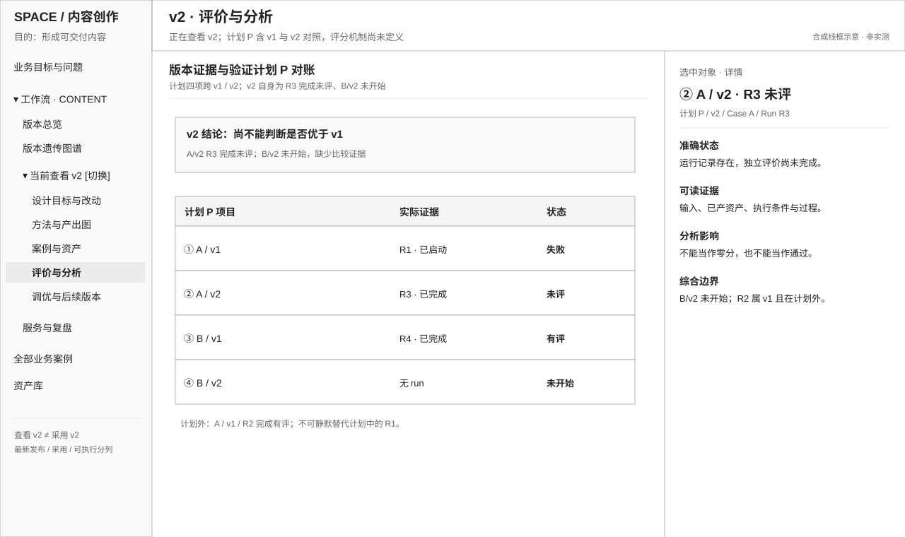](../diagrams/product-wireframes-20261009/06-evaluation.svg)

这里的首要判断是“证据足不足以支持这个结论”。顶部说明准确版本、目标、案例集合／窗口、评价标准和仍未知之处；主体连接综合分析、原始评价与计划对账。列表必须保留失败、未开始、未评和计划外运行的区分，不能只展示成功作品。

点击评价，读准确被评资产、判者、标准、依据与适用范围；点击计划项进入已有 run，或说明尚无 run。需要读关系与过程时进入同一 Case／方法画布，不复制证据。输入、环境或标准变化限制结论，评分办法仍待讨论。

此页形成有范围的分析；采用和调优需要另一次明确决定。它可以引向补证据、校准标准、方法改动、继续旧版或项目问题。

## P07 调优与后继版本

[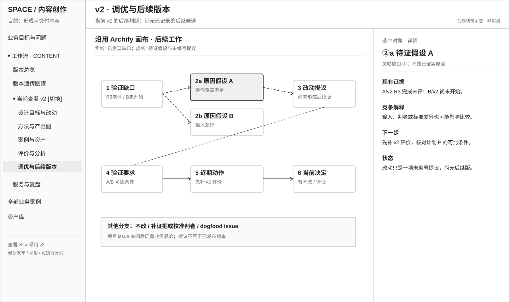](../diagrams/product-wireframes-20261009/07-tuning.svg)

中央关系解释“观察到什么 → 有哪些竞争原因 → 为什么选择这项改动 → 产生哪版候选 → 怎样验证 → 作了什么决定”。点任一对象读相应证据、理由和未解决问题；相关操作在详情或分屏中进行，原图作为上下文保留。

这里允许分支：不改、补材料、校准判者、停止投入或提出 dogfood issue。共享存储、SDK 等项目改进是依赖关系，不能伪装成一个 Prompt 候选；项目交付后回到原业务复验。产生 v2 不等于 v2 改善，更不等于已经采用。

P03 从一个版本看“我从哪里来”，P07 从现有证据看“接下来怎样变”；两页共用同一套问题、变更和验证记录。

## P08 Workflow 版本遗传图谱

[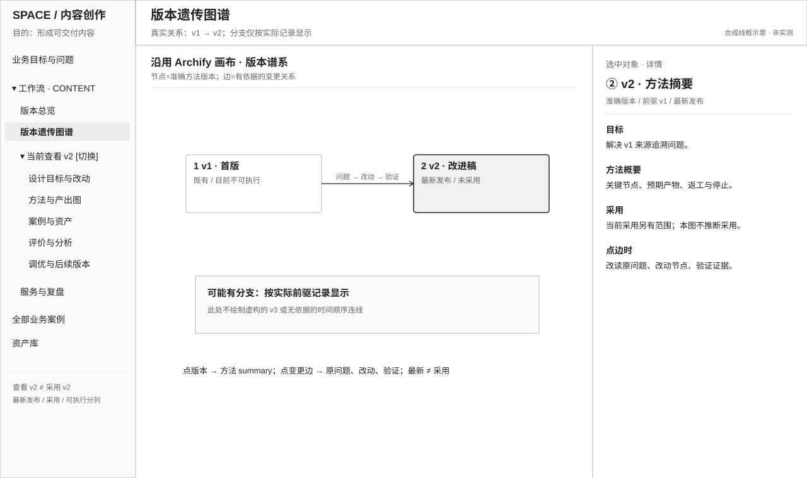](../diagrams/product-wireframes-20261009/08-lineage.svg)

节点代表准确版本，边代表实际记录的前驱／变更关系。采用范围、候选状态和执行可用性可辨认；创建时间不自动变成继承关系，版本新不等于更好。

点版本先在侧面读目标、变化和证据摘要，再进入该版完整方法；点变更关系读原问题、分析、改动、验证与采用决定。实际存在的分支、未采用候选和回退历史保留；未记录的祖先或理由标未知。线框中的示意分支不宣称生产数据已经存在。

## P09 服务与复盘

[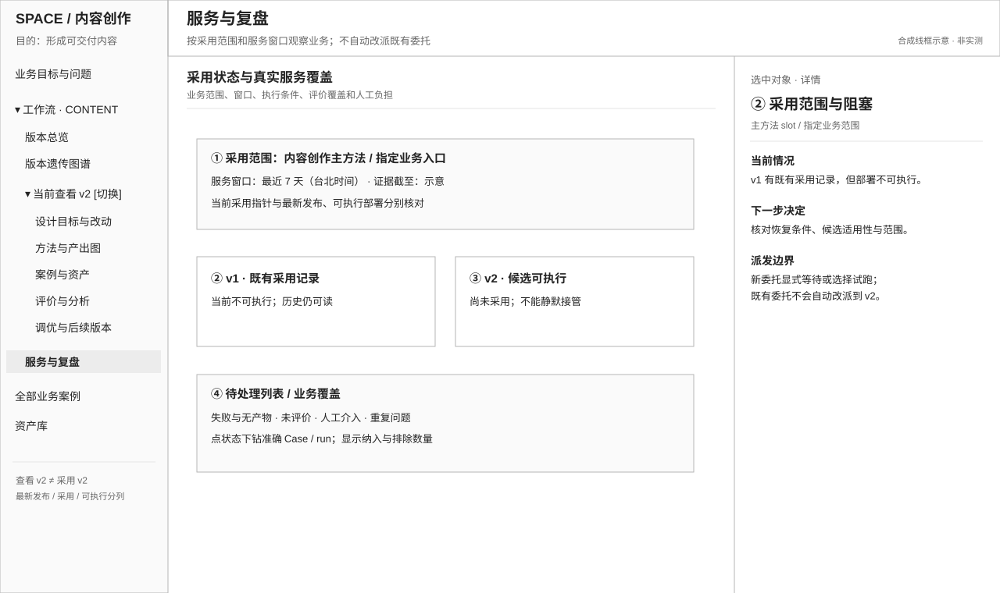](../diagrams/product-wireframes-20261009/09-service.svg)

先从采用范围看日常业务，再从观察窗口看表现、失败、人工负担及评价覆盖。这里帮助判断是否继续使用、补充验证、收窄范围或进入改进；不把同一版本所有用途的数据混为一个稳定性结论。

点击待处理事项回到准确 Case 或运行；点击采用决定读证据、范围和后果。当采用版不可执行而候选可执行时，新委托仍需明确选择等待或有记录的替代；查看研发候选不会改变日常工作。正在执行的 run 保持原绑定。

## P10 全部业务案例与资产库

[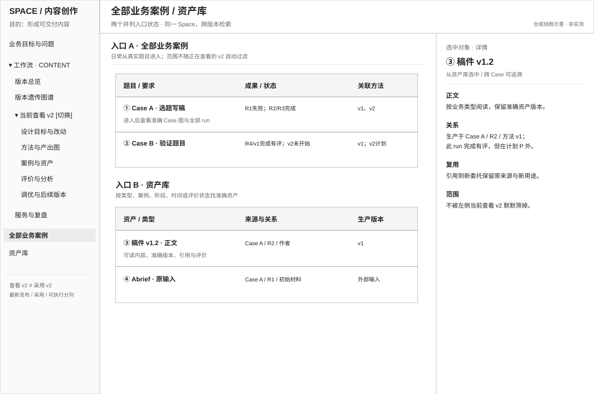](../diagrams/product-wireframes-20261009/10-library.svg)

两者分别支持“不知道用了哪版方法，只知道要找哪项业务”和“从一份材料或产物出发”。它们是跨版本入口，不继承方法页当前选中版本的隐含筛选。

全部案例按业务名称、结果和待处理状态检索，点击 Case 进入 P05 同一实际画布。资产库按内容、类型、Case、方法和运行检索，点击复用同一阅读器，可回到生产版本、前稿及评价。将资产用于新业务时引用准确版本和新用途，保留原来源。

检索入口使用列表并不改变图中心基础：用户找到对象后，仍沿实际关系阅读和处理；不必把大量无关资产一次铺满图。

## P11 首版设计与新委托是操作，不是新的后台

[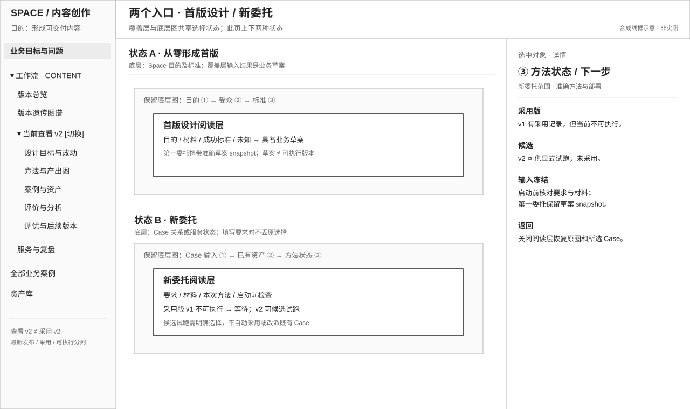](../diagrams/product-wireframes-20261009/11-actions.svg)

**首版形成：** 从 Space 的业务目的、样例、标准和未知出发，由设计者或受托 Agent 提出有理由的节点、交付边界和执行合同；Agent 经 skill＋CLI 保存草案，前端以 Archify 展示方法与节点详情并读回设计依据。保存草案不宣称已可执行。第一项委托必须关联当时的准确草案，后续修订不改写旧记录；模板只能提供起点，不能替代业务推导。

**新业务委托：** 用户从业务入口或当前方法表达用途、材料和所选方法，Agent 经 skill＋CLI 保存或显式发起；前端读回选择依据、准确输入、执行条件和结果。已采用但不可执行时可保留委托并等待，或由有权者明确选择替代；候选试跑不自动成为采用。材料不足在原 Case／run 旁处理，原输入和失败历史保留。

写入后的前端读回回到生成的 Case、草案或决定，能核对“改变了谁、还缺什么、下一步在哪里”。已有或未来可选的轻交互可以使用分屏或覆盖层，关闭后恢复原工作范围；不再创建一套与画布脱节的管理页面。

## 如何检验这份设计，而不再重做交互原型

逐条沿线框读通：从目的找到方法；从方法找到全部已记录案例；从案例读准确资产和评价；从评价解释改法；从候选看验证、采用及下一次委托。每一步说清当前对象、可得到的依据、尚未知事项和下一动作影响谁。找不到时修原页面逻辑，不新增一个同名菜单了事。

本轮线框保留了“计划缺项、材料不足、采用版不可执行”和“草案→第一委托”反例。现有 Archify 的交互能力直接作为基础，缺的内容和关系逐项映射到其画布与详情。后续确定实现范围时再对照真实数据与接口；静态线框不证明模型效果，也不预设一次实现所有页面。

[上轮交互试验](prototype-round.md)保留为历史证据，已停止迭代。它验证过部分范围和身份关系，但未沿用已确认的 Archify 主交互，不能作为当前界面方案已被接受的证据。
