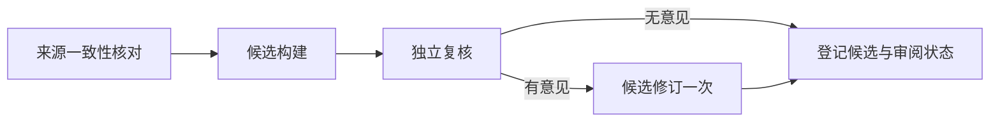

# 自媒体分析工作台

从现有 self-media 工作台迁移，保留单帖、单博主分析及关联证据/研究过程。使用 React 19、Vite、Express、PostgreSQL；显式执行方法位于 `prompts/`，原方法及确定性取证工具位于 `.agents/skills/`。不包含多博主对比、知识 Wiki、发布或学习回路。单博主内部的跨帖综合、批量提交任务仍保留。

单帖主报告按 Builder 原文展示「内容还原、编导逻辑、画面与剪辑」。证据贴在结论旁；审阅、修订与工作流进度另外可达。当前入口 `/analyze` 查看已有单帖，从博主作品进入可重跑；旧 `/api/runs` 已退休，不是通用任意链接的单帖入口。

## 原核心阶段

以下按保留代码阶段绘制，不引入新产品流程。博主阶段来源：`packages/research/src/creator-research/service.ts`；单帖审阅阶段来源：`packages/research/src/workflows/simple-review.ts`。


最后阶段原代码标签为「发布到原有 Dashboard」，意为交付研究报告，不是平台发帖。



复核技术失败保留候选并标明审阅不完整；修订版未复审不能继承原版审阅通过。博主综合使用冻结作品与单帖分析，再独立复核并按需修订。运行完成或测试通过不等于分析结论正确。

PostgreSQL 模式下，新增博主完成采集和媒体冻结后，视频自动进入与报告页重新研究相同的 `post.analyze v11`；综合使用 `creator.synthesize v8`。原有采集预算、分层、媒体缺口与暂定综合门槛继续生效。图文保持独立图文分析路径，不冒充已通过视频来源核对和审阅。运行入口仅支持 PostgreSQL 与官方 Agents SDK。

## 启动

在仓库根目录统一安装，Node.js 24、pnpm 10.28.2；共享执行代码只在根目录 `vendor/agent-workflow` 一份。

```sh
pnpm install
pnpm --filter @creator-lab/analysis dev
```

默认页面 `http://127.0.0.1:5173`，API `http://127.0.0.1:4310`。根目录可用 `pnpm --filter @creator-lab/analysis typecheck`、`test`、`build`、`smoke:entrypoints`；这些脚本会先构建共享执行包。

在本目录按 `.env.example` 配置：提供 `SELF_MEDIA_DATABASE_URL`、独立的 `SELF_MEDIA_MANAGED_MEDIA_DIR` 与 `SELF_MEDIA_RUNTIME_DIR`。PG 保存任务、租约、批次、工作流事实和文本资产；媒体保存到受管目录，runtime 只保存可重建缓存。使用已完成数据库初始化的专用库，应用也会运行幂等表迁移。

模型执行使用共享 `agent-sdk` 包的 `OpenAIAgentsSdkRunner`：官方 `@openai/agents@0.20.0` 的 Agent / Runner / tool 负责执行，SIWC 仅适配 ChatGPT 授权与单次 Responses 请求，需要独立的 Continue with ChatGPT 授权；不会读取 Codex 凭据或回退到 API 计费。构建后在仓库根目录运行 `node vendor/agent-workflow/packages/agent-sdk/dist/cli.js login` 完成授权，`models` 可查询授权可用模型。真实采集还需要 `ego-browser` 登录态或 RedFox API 配置，以及 ffmpeg/ffprobe、Python、转写/OCR工具。新运行默认 Luna，模型可按角色配置。历史模型记录不改写。

生产运行：先 `pnpm --filter @creator-lab/analysis build`，再 `pnpm --filter @creator-lab/analysis start`。可关闭内嵌worker并单独运行 `start:worker`；只查看材料必须使用下面的只读模式。

## 显式导入原数据

源码仓库不包含私人数据库、报告或媒体。查看已有结果时，先创建 SQLite 一致性备份，不直接复制活动数据库文件：

```sh
cd workbenches/analysis
python3 scripts/snapshot-runtime.py \
  --source /absolute/path/to/self-media/.runtime \
  --output /absolute/path/to/analysis-view-snapshot
pnpm exec tsx scripts/import-sqlite-to-postgres.ts \
  --source /absolute/path/to/analysis-view-snapshot --workspace creator-lab-analysis

# 核对 dry-run 后，使用私有环境变量 ANALYSIS_DATABASE_URL 指定目标库。
pnpm exec tsx scripts/import-sqlite-to-postgres.ts \
  --source /absolute/path/to/analysis-view-snapshot --workspace creator-lab-analysis \
  --media-root /absolute/path/to/analysis-media --execute
```

快照的 `runs/` 指向原始报告；导入器以只读方式读取快照，原 ID、状态和引用保持不变，文本正文进入 PG，大媒体复制后校验哈希。重复导入会对账并拒绝冲突。历史任务 ID 另行冻结，启动新 worker 不会自动重跑旧队列。导入完成后使用独立 runtime 缓存启动，不能把它指向快照或原仓库。

仅查看时使用 `SELF_MEDIA_READ_ONLY=true SELF_MEDIA_EMBED_WORKERS=false`；这些设置拒绝写请求并禁用 worker。旧 SQLite 仅由独立的只读导入脚本读取；应用不再提供 SQLite 执行或查看模式。证据仓库另通过 `SIGNAL_ROOM_EVIDENCE_ROOT` 指定。业务分支与迁移验收见 [迁移记录](docs/storage-execution-migration.md)。

可通过 `/creators` 浏览博主，`/analyze` 浏览已有单帖，报告页提供关联 workflow 与 evidence。内容能否复述、证据是否支持结论仍须实际阅读判断；迁移检查仅证明接口与执行结构保持可用。
