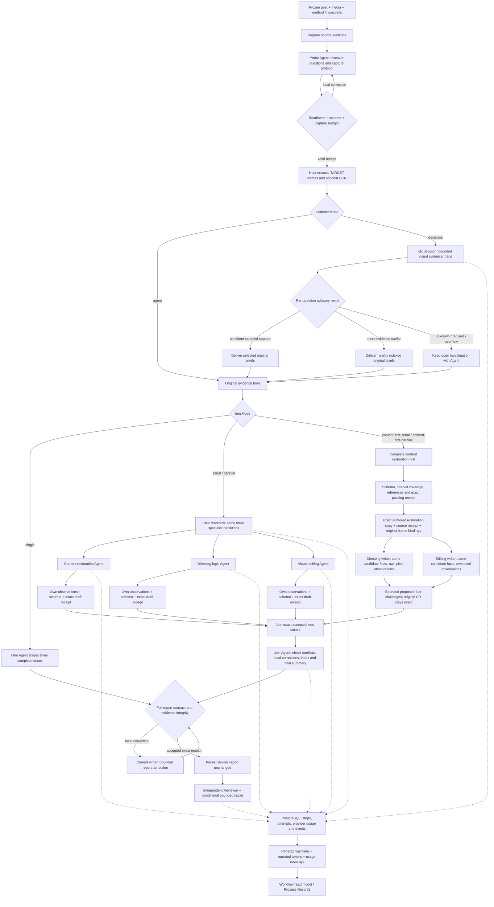

# Builder evidence routing and independent lens execution

These paths are opt-in experiments in `ResponsesResearchRunner`. The default remains `evidenceMode: agent` and `lensMode: single` until report-quality comparisons support adoption. All writing continues through the official OpenAI Agents SDK. The shared workflow runtime persists child steps, decisions, attempts and events in PostgreSQL.

The default Builder prose method remains `responses-post-builder-v1.md` v4.14. The v4.15 handoff instructions live in `responses-post-builder-content-first-v1.md` and are selected only by the explicit content-first configuration (including its specialist definitions). The first full handoff regression did not pass the speed and critical-fact gate; its runtime succeeded, but the candidate repeated a wrong object/time association in editing teaching. It is not adopted. Local scheduling and unseen-post expansion were withheld after that result. Interface tests and stored receipts do not reverse this quality decision.

For `serial`, the three specialist steps execute in order. For `parallel`, `ctx.parallel` schedules the same steps with concurrency three. Scheduling is recorded in the child workflow configuration, not mixed into the frozen evidence digest or specialist definition. Separate full runs still generate their own probe and capture protocol; report those differences when interpreting elapsed time.

The two `content-first-*` modes are separate opt-in candidates. CR must complete before either interpretation starts. Both receive the same exact accepted CR value and its source receipt; their private text copy is verified against the source draft's canonical bytes. The host does not generate a second fact summary. `content-first-serial` writes DL then VE; `content-first-parallel` overlaps those two with concurrency two. The existing single Agent already shares its SDK history across the lenses: explicit handoff adds a versioned, challengeable boundary rather than introducing fact sharing for the first time.

Each interpretation independently reads CR and its bound original frame anchors. `challenge_builder_fact` records at most eight proposed disagreements per branch, with an existing CR prose pointer, exact quoted claim, evidence actually read in that branch and optional paths within its own lens. It cannot edit CR or certify the objection. Proposals persist beside the branch and travel with its result to the join Agent. Join receives all exact lens values and challenges, is instructed to inspect original evidence and trace affected fields across the lenses and `finalSummary`, and may locally revise them. No program check proves that the model found every conflict or handled every proposal correctly; independent report review remains necessary.

## Decisions boundary

The Planner takes actual capture questions, chooses a bounded set of SHA-verified TARGET images and batches finite questions into one Decisions request. It does not ask another prose Agent to generate those questions. Missing expected observations are explicitly identified; missing questions, input limits, refusals and provider failures remain open Agent work.

The result is an advisory choice, not a factual conclusion. Confidence is uncalibrated: a high score cannot certify semantic coverage or report quality. Weak `needs_more_visual_evidence` choices may conservatively deliver additional pixels, marked `tentative`. Supplemental images currently come from already indexed original frames; the runner does not use the optional new-capture hook.

The selected pixels are then delivered to each writer by verified evidence tools. A Decisions request does not grant the writer image-inspection credit. Each route is recorded with `ctx.decide`; provider inference is separately recorded with `ctx.decision`.

## Harness guarantees and limits

- Probe context includes up to 16 timestamped original DENSE samples spread across the indexed timeline, including both ends. This avoids relying on only opening and detected-cut overviews. Every selected ref is required by readiness; oversized bundles retain explicit missing reads. These are samples, not proof of continuous coverage or correct visual interpretation. A detector's long shot interval does not imply an unchanged action throughout it.
- Each physical Builder Responses request has a five-minute absolute deadline, including an active nonterminal stream. The SDK retains at most one safe transport retry; a deadline therefore does not impose a five-minute limit on the entire Builder. Failed requests have unknown usage, and successful retry usage cannot fill that gap.
- Evidence metadata forks do not load the entire video. Actual reads still validate content hashes. Each specialist owns its text/image observations and draft directory.
- Supplemental candidates are verified before deduplication by actual content SHA; an alias of an already selected image does not consume a supplemental slot. Different crops at the same timestamp remain distinct evidence.
- A specialist can stage or revise only its assigned lens. Completion requires local evidence readiness and its own exact passing receipt. Cross-branch receipts are rejected. Malformed or missing JSON patch paths return correctable tool feedback with the unchanged current draft receipt; cancellation and storage/hash failures still abort.
- The host imports each accepted lens value unchanged, validates it again, and records source and join receipts. The join Agent supplies interpretation, conflict corrections, the knowledge index and `finalSummary`; the host does not write conclusions.
- Evidence batches shrink on aggregate transport overflow without marking omitted images as read. Oversized single images and missing evidence remain explicit errors or follow-up work.
- Parent cancellation propagates to child workflows and model calls. Parallel work is awaited before failure returns. Persisted child steps support explicit replay, but this adapter does not promise automatic cross-process recovery of an interrupted provider request.
- Content restoration is checked for declared interval coverage at lens staging and final validation under the current summary contract. Gaps beyond the existing half-second timestamp tolerance return exact intervals to the writer; a summary cannot replace missing prose blocks. Unknown content must remain explicit. Historical saved reports are not rewritten. This detects omitted ranges, not semantic accuracy.
- Schema, readiness and receipt checks prove structural and access properties. They do not prove content restoration accuracy or editing-analysis depth.

## Controlled comparisons

Use `scripts/benchmark-post-workflow-run.ts` with explicit `--evidence-mode agent|decisions` and `--lens-mode single|serial|parallel|content-first-serial|content-first-parallel`:

| Arm | Evidence | Lenses | Purpose |
| --- | --- | --- | --- |
| A | agent | single | Existing full-workflow control |
| B | decisions | single | Evidence-routing intervention |
| C | agent | serial | Split-agent control |
| D | agent | parallel | Scheduling intervention against C |
| E | agent | content-first-serial | Explicit restoration handoff candidate |
| F | agent | content-first-parallel | Same handoff structure, interpretations overlap |

All arms include source check, Builder, independent review and conditional repair, and use the same frozen media and model configuration. Downloads are outside this frozen-input comparison. Reports are isolated candidates; benchmark execution does not overwrite the current workbench result.

Measure full elapsed time, per-stage intervals, Responses requests, Decisions requests and tool-call purposes separately. Summing parallel branch durations does not give end-to-end latency. Inspect final report prose against original frames: continuous restoration, critical facts, verified cuts, information changes, counterfactuals, filming conditions and performance-data limits. Empty Reviewer findings are not quality acceptance. A single run per arm is a diagnostic sample, not a stable speed estimate.

Use exactly the same accepted CR, actual probe/capture/images and role contract for a local E/F scheduling comparison; two independent full runs do not freeze those generated inputs automatically. Include CR preparation and later join/review/repair when reporting full pipeline cost. A local interpretation benchmark cannot stand in for full workflow latency. Keep known regression clips separate from genuinely unseen transfer clips, and retain failed candidates.

## Step duration and token accounting

The shared runtime projects persisted step, attempt and provider events into `stepMetrics`. Every step exposes its elapsed interval and attempt history; model steps also expose input/output tokens and available cached-input/reasoning details. Coverage is `complete`, `partial`, `unavailable` or `not_applicable`. A failed request without provider usage remains unknown: a later successful retry does not make the whole step's token count complete. `reportedTokens` is only the observed lower bound when coverage is partial.

The workflow read model includes descendant steps. The shared Space Process API and its Records panel show the selected Run's own steps; child Runs remain separate. Parallel and nested duration sums describe overlapping work, not total workflow latency. See the [shared frontend integration contract](../../../vendor/agent-workflow/docs/frontend-integration.md) for fields, incremental updates and display rules.

Every physical Responses POST now emits sanitized request-payload aggregates alongside its turn/attempt identity: exact serialized body bytes, image occurrences and unique inline-image hashes, repeated decoded inline-image bytes, function-call argument bytes and message input-text bytes. Non-inline/unrecognized image URLs remain a separate unknown-size count. Definitions overlap and cannot be added together. These describe the actual body sent, not model tokens, inference time, cache savings or billing. Tools still return exact draft receipts, and completed long arguments/pixels may remain in subsequent SDK input history; this instrumentation does not compact or change that history.
