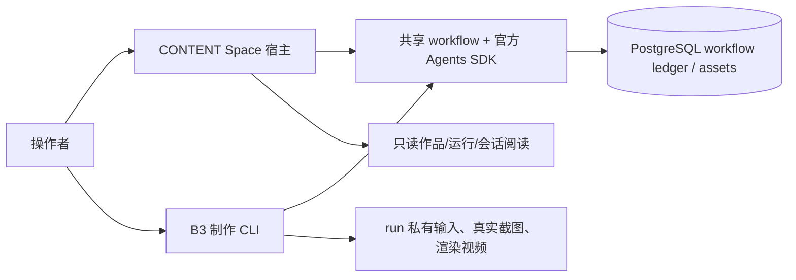

# 架构

创作把业务 workflow、工具授权、标准和作品阅读接入共享 `agent-workflow`。持久运行账本统一进入 PostgreSQL；节点模型调用统一经 `OpenAIAgentsSdkRunner` 与 SIWC auth。创作不复制通用执行引擎，也不继续运行 Codex/SQLite 原型。

| 责任 | 实现位置 | 当前边界 |
| --- | --- | --- |
| CONTENT 方法、版本和案例运行 | `src/spaces/`、`scripts/content-space.ts` | Space PG 数据是正本；模型执行由共享 SDK runner 提供 |
| B3 完整制作 workflow | `src/stages/b3.ts`、`scripts/run-b3.ts` | 保留配音、装配、核验、快照、渲染；用 PostgreSQL ledger + SDK runner |
| B3 受限节点工具 | `src/stages/b3-agent-tools.ts` | 设计节点只写 `frames-spec/` 和调用固定检查；检查节点只读当前轮真实图片 |
| 业务呈现与阅读器 | `apps/space-workbench/`、`src/spaces/readers.ts` | 不在加载/刷新页面时执行模型 |
| 历史 Codex/SQLite 文件 | 原 `.local` 数据和 `history-sqlite-archive.ts` | 保留原数据；归档只读校验，不再提供旧运行服务 |

旧 B1/B2 workflow 与判断文档仍可作为历史材料阅读，但当前内容主线是合并后的 CONTENT。成片制作质量、模型质量和创作者验收需根据真实 run 分开判断；演示 fixture 与构建成功都不构成这些结论。

详细入口见[运行与历史数据边界](business-workbench.md)，作品交接合同见[作品档案](brief-and-handoff.md)，业务 B3 流程见[成片 workflow](../04-workflows/b3.md)。
