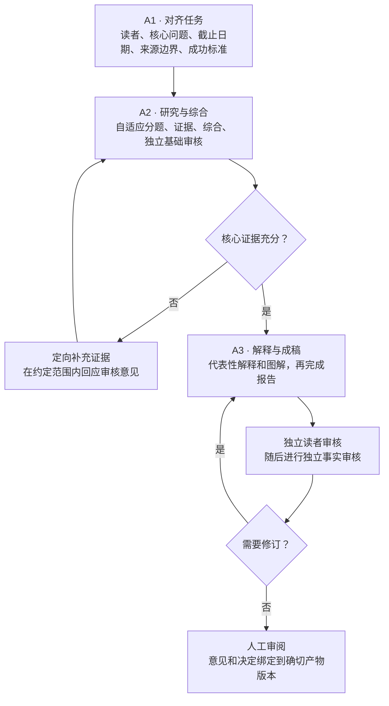

# 研究工作台

研究工作台是 Creator Lab 中独立运行的一个产品模块，使用 Node 24、Fastify、React/Vite、PostgreSQL 与独立 worker。研究执行使用上游 Agent Workflow ledger、官方 OpenAI Agents SDK 与已有 SIWC 授权；七个研究 Skills 保存在本目录的 `.agents/skills/`，每个运行冻结其完整内容。所有角色默认 `gpt-6-luna` / medium。

## 启动

在 Creator Lab 仓库根目录安装依赖后，API 与 worker 会自动读取本工作台被 Git 忽略的 `.env`。首次配置可复制下列私有连接设置到 `workbenches/research/.env`，也可直接在 shell 设置：

```sh
pnpm build
pnpm research
```

数据库 URL 必须指向研究工作台使用的 PostgreSQL 数据库；API 和 worker 都从该变量读取配置。打开 <http://127.0.0.1:4327>。API 仅监听本机，并提供构建后的网页。研究 worker 独立运行；需要执行研究时，在第二个终端运行 `pnpm research:worker`。启动 API 不会自动启动 worker 或创建研究任务；用户发起新任务后，worker 才会调用已有 SIWC 授权。若尚未连接 ChatGPT，在首次运行前执行 `pnpm --filter @signal-room/workflow-agent-sdk exec workflow-siwc login`。开发网页可运行 `pnpm --dir workbenches/research dev:web`，Vite 地址为 <http://127.0.0.1:4328>，并将 API 请求代理到 4327 端口。

## A1 → A2 → A3



Worker 执行有界的工作流尝试；API 和阅读器展示不可变产物及其精确版本上的意见。软件检查与模拟读者结果不能证明真实模型质量或用户接受。

## 数据边界

既有内容与历史数据是保留对象。PostgreSQL 是新运行的唯一 live store；runtime 不会打开旧 SQLite 文件。历史研究库已只读导入新 PostgreSQL：旧运行仍在现有 UI 可读，且被标记为不可恢复/修改的历史记录；旧模型标签保持原样。原始 SQLite 数据库、导出报告、私有 traces 和来源文件留在旧路径；原选题清单与 116 个来源文件另有字节一致副本位于本工作台 `.local/content/`。历史报告正文从 PostgreSQL 账本读取，首次阅读时生成新的本机 Markdown 派生文件。

默认数据位置相对于本工作台目录：

- `.local/content/manifest.json`：选题与来源清单；来源文件按清单中的相对路径存放。清单不存在时，API 可以启动并返回空选题列表。
- PostgreSQL：新研究运行、宿主排队/租约/幂等记录、协作事件和工作流产物账本。
- `.local/artifacts/`：从结构化产物导出的 Markdown 文件。

显式只读导入历史 SQLite 的命令（按原文件/WAL SHA 幂等）：

```sh
node workbenches/research/scripts/import-sqlite-archive.mjs /Users/hhh0x/self-publish/research-workbench/.local/state/research.sqlite
node workbenches/research/scripts/import-sqlite-archive.mjs /Users/hhh0x/self-publish/research-workbench/.local/state/collaboration.sqlite
node workbenches/research/scripts/import-sqlite-archive.mjs --archive-only /Users/hhh0x/self-publish/research-workbench/.local/backups/20260923-storage-native/research.sqlite
```

数据库原件不会被修改。research.sqlite 会将原始表/行保存在归档表，并将原工作流账本投影到共享 PostgreSQL ledger，以便现有阅读器打开历史报告；投影运行保持只读和原有状态，不会被伪装成新 SDK 运行。历史来源副本、文件资产和 private traces 位置、行数与保留边界见[存储说明](docs/storage.md)。

选题与来源目前是只读输入，产品没有原生的选题/来源登记界面或写入 API。准备好清单和来源文件后，界面会把所选来源冻结到新运行中；清单格式和校验边界见[存储说明](docs/storage.md)。历史报告文件不会被当作已完成的 A1/A2/A3 工作流导入。若将既有文本登记为来源，它也只是普通来源材料。

更多实现说明见[架构](docs/architecture.md)、[开发](docs/development.md)和[存储](docs/storage.md)。这些文档中的验证记录对应各自标注的源工作台日期。

## 本次迁移核验

迁移后验证记录在本轮完成后追加。模型产物质量与用户接受仍需分别实证。
