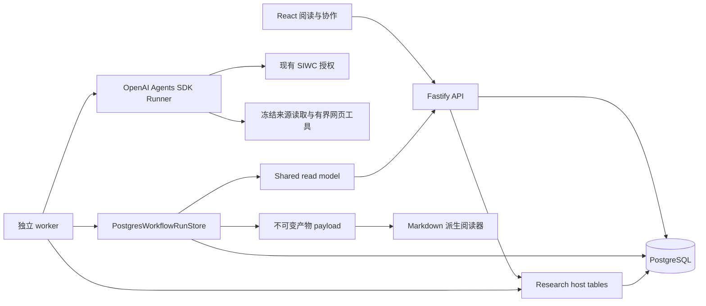

# 研究工作台架构

研究工作台保留自己的 API、React 阅读/协作 UI、A1/A2/A3 流程、报告资产协议和私有资料目录；执行底座统一到 Creator Lab 的 Agent Workflow PostgreSQL ledger 和官方 Agents SDK。

API 与 worker 各自创建 PostgreSQL pool。`WORKFLOW_DATABASE_URL` 是必填运行配置，host 操作和 shared ledger 使用同一 Postgres client/事务完成入队；存储查询按固定物理 workspace 作用域，任务列表与复用引用再按冻结输入的逻辑 workspace 和 topic 隔离。产品表负责研究领域输入快照、任务队列、幂等、取消、租约及协作事件；shared RunStore 是步骤/尝试/事件/产物的唯一正本。协作意见绑定 `{id, revision, sha256}`，审核通过不等于用户接受。

模型请求由 `OpenAIAgentsSdkRunner` 通过官方 Agents SDK 的 `Agent` 和 `Runner.run` 执行，host 仅映射冻结 prompt、JSON schema、Skill bundle 和按 attempt 绑定的工具。SDK云 tracing关闭；workflow事件与受限调用元数据保存在 ledger。工具只提供冻结材料读取和显式网页检索/读取，没有 Codex CLI、Codex credentials、shell 或任意本机文件读取。

A1 对齐目标与读者，A2 自适应分题、收集证据并审核综合稿，A3 形成代表性解释和图解、报告、读者审核及事实审核。输入来源在提交时按哈希冻结，历史依据可按精确版本复用。报告 Markdown 是从 artifact payload 派生的阅读器副本，不覆盖 payload 正本。

旧 SQLite 数据库和本机报告、媒体、私有 traces 保持在原路径；runtime 不打开旧 SQLite。显式只读导入器会保留逐表归档，并将 workflow ledger 原记录投影到 PostgreSQL，使历史报告继续由当前 UI 阅读。投影记录标为只读，保留旧 run/artifact IDs、运行状态、模型标签和方法版本，不会当作新 SDK 运行恢复。
